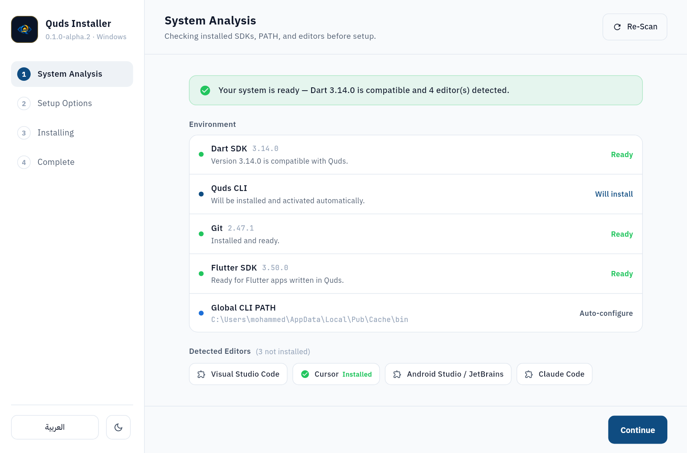
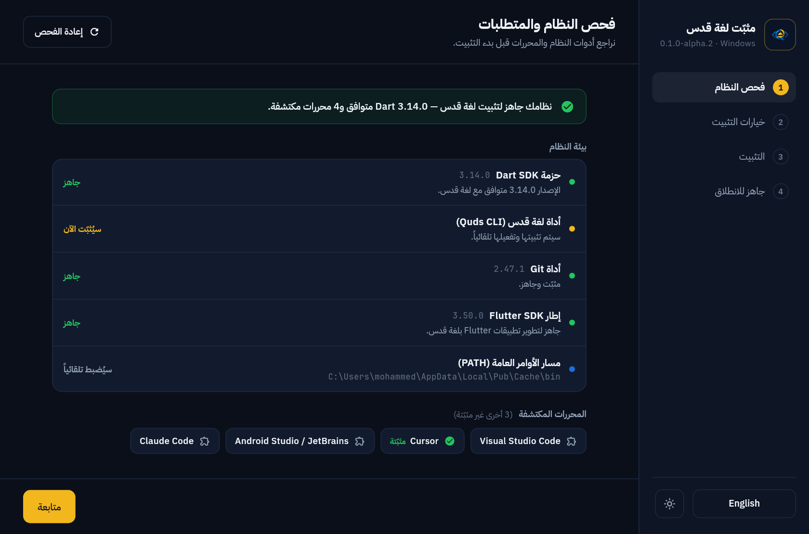
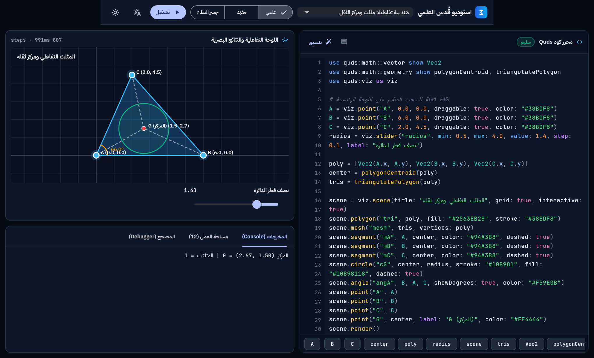
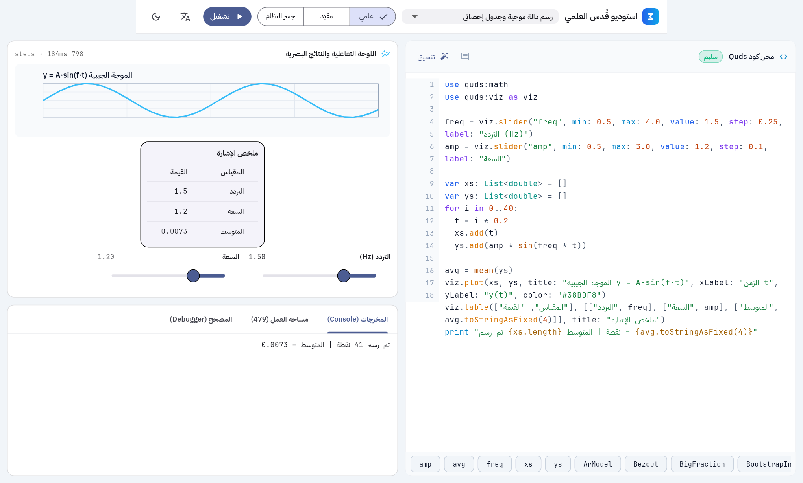
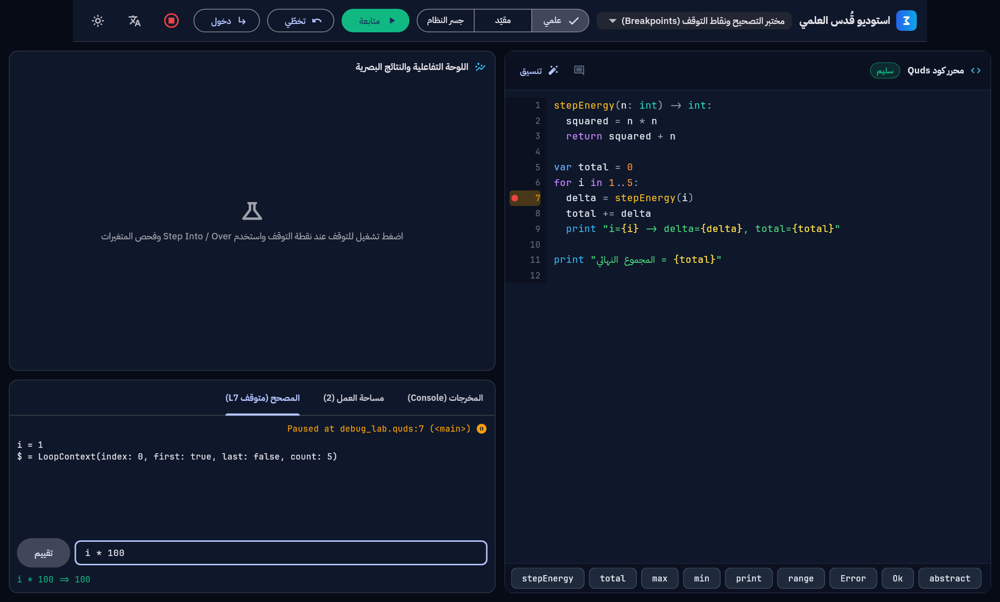

# Quds

[](https://pub.dev/packages/quds)
[](https://pub.dev/packages/quds/score)
[](https://github.com/MohammedAsaadAsaad/quds_lang/actions/workflows/dart.yml)
[](LICENSE)

> **Status: Public Alpha (`0.1.0-alpha.2`)** — A statically typed, indentation-based general-purpose language that compiles to clean, readable Dart **and** runs directly inside a pure-Dart **Register Bytecode VM & Embedded Interpreter** — with full Dart/Flutter interop, zero `build_runner` boilerplate, a single-file graphical **Desktop Installer**, an interactive **Quds Studio** playground, and an integrated CLI, LSP server, and debugger.

Quds keeps Dart's type safety, null safety, AOT/JIT/Web/Flutter ecosystem, and zero runtime overhead — while removing braces, semicolons, closing-parenthesis pyramids, and repetitive model boilerplate. The formal language design is version 1.2 in [the specification](docs/QUDS_LANGUAGE_SPECIFICATION.md).

[Install & Desktop Installer](#install-quds) · [Quick Start](#quick-start) · [Why Quds?](#why-quds-side-by-side-with-dart) · [Embedded VM & Benchmarks](#embedded-interpreter-register-bytecode-vm--benchmarks) · [Quds Studio](#quds-studio--interactive-scientific-ide) · [Standard SDK](#built-in-quds-standard-sdk) · [Documentation](#documentation)

---

## Install Quds

Choose either the **Graphical Desktop Installer (recommended)** or the **CLI**.

### Option 1 — Quds Desktop Installer (Recommended)

[**Quds Desktop Installer (`quds_installer`)**](installer/README.md) is a calm, bilingual (**Arabic RTL & English LTR**, Dark & Light themes) graphical setup wizard distributed as a **single clickable file** — no ZIP extraction, no console windows, and no FUSE requirement on Linux:

| Platform | Direct Download (Single File) | Notes |
| --- | --- | --- |
| **Windows (x64)** | [Download `Quds-Installer-Windows-x64.exe`](https://github.com/MohammedAsaadAsaad/quds_lang/releases/download/v0.1.0-alpha.2/Quds-Installer-Windows-x64.exe) | Single GUI `.exe` with embedded icon — double-click to run directly |
| **macOS** | [Download `Quds-Installer-macOS.dmg`](https://github.com/MohammedAsaadAsaad/quds_lang/releases/download/v0.1.0-alpha.2/Quds-Installer-macOS.dmg) | Native `.dmg` containing **Quds Installer.app** |
| **Linux (x64)** | [Download `Quds-Installer-Linux-x64`](https://github.com/MohammedAsaadAsaad/quds_lang/releases/download/v0.1.0-alpha.2/Quds-Installer-Linux-x64) | Standalone binary — `chmod +x Quds-Installer-Linux-x64 && ./Quds-Installer-Linux-x64` |
| **VS Code / Cursor Extension** | [Download `quds-0.1.0.vsix`](https://github.com/MohammedAsaadAsaad/quds_lang/releases/download/v0.1.0-alpha.2/quds-0.1.0.vsix) | Also installed automatically by the installer or `quds install` |

All release files are published on [GitHub Releases (`v0.1.0-alpha.2`)](https://github.com/MohammedAsaadAsaad/quds_lang/releases/tag/v0.1.0-alpha.2).

**What the Desktop Installer does automatically:**
- **Smart Environment Scan:** Detects your OS, `Dart SDK` (`>=3.3.0 <4.0.0`), `Git`, `Flutter SDK` (optional), existing `quds` CLI, and `pub-cache/bin` on `PATH`.
- **Guided Prerequisite Assistant:** Provides OS-native setup commands (`winget`, `Homebrew` / `Xcode CLT`, `APT` / `Snap`) with one-click automated execution where supported.
- **7 Editor & AI Tool Integrations:** Automatically detects and configures **VS Code**, **Cursor**, **Windsurf**, **VSCodium**, **VS Code Insiders**, **Android Studio / JetBrains**, and **Claude Code**.

<table>
  <tr>
    <td align="center" width="50%">
      
      <br /><sub><b>English · Light Mode</b> — Environment scan &amp; prerequisite assistant</sub>
    </td>
    <td align="center" width="50%">
      
      <br /><sub><b>Arabic RTL · Dark Mode</b> — IBM Plex Sans Arabic &amp; JetBrains Mono</sub>
    </td>
  </tr>
</table>

### Option 2 — Install via CLI (`pub.dev`)

Requires [Dart SDK](https://dart.dev/get-dart) `>=3.3.0 <4.0.0`:

```sh
dart pub global activate quds 0.1.0-alpha.2
quds install
```

`dart pub global activate` installs `quds` into `~/.pub-cache/bin` (Linux/macOS) or `%LOCALAPPDATA%\Pub\Cache\bin` (Windows). Open a new terminal if your shell does not see `quds` yet.

- `quds doctor` checks Dart, Flutter, `PATH`, `quds` CLI, and editor integrations.
- `quds eval 'use quds:math; print mean([2.0, 4.0, 6.0])'` executes Quds expressions instantly on the embedded VM.
- `quds repl` starts an interactive persistent Quds session.
- `quds help` lists every available command.

---

## Quick Start

### Console / CLI Program

```quds
square(n: int) -> int = n * n

main():
  name = "Quds"
  print "Hello {name}"
  print square(6)
```

```sh
quds create hello_quds
cd hello_quds
quds run lib/main.quds
```

`quds build` writes clean, standalone Dart under `.dart_tool/quds/out/` (with source maps) without touching hand-written `.dart` files. Use `quds build --package` to generate publishable `lib/*.dart` files for dual Quds + Dart packages.

### Flutter App

```sh
quds create --f hello
cd hello
quds run -d chrome    # or -d windows / -d linux / -d android
```

- `quds run -d <device>` compiles `lib/main.quds` and its dependencies (including external pure-Quds packages under `lib/quds_gen/_packages/`), prints live step-by-step progress, and launches Flutter with automatic Hot Reload on save (`r` reload, `R` hot restart, `q` quit).
- `quds build apk --release`, `quds build web`, `quds build windows`, and `quds build linux` compile Quds sources before invoking Flutter. See [project commands](docs/PROJECT_CLI.md) and [Flutter live updates](docs/FLUTTER_LIVE_UPDATES.md).

### Migrate an Existing Dart or Flutter Project

Convert an existing Dart or Flutter project to Quds safely with the built-in AST migrator:

```sh
cd your_dart_or_flutter_app
quds migrate
```

`quds migrate` runs in three safe steps:
1. **SDK & feasibility check** — verifies Dart SDK compatibility (`>=3.3.0 <4.0.0`), parses `lib/**/*.dart` via the Dart AST, verifies every converted file against the Quds parser, skips generated files (`*.g.dart`, `*.freezed.dart`), and reports any file that needs manual review with exact line numbers.
2. **Automatic `lib/` backup** — copies your entire `lib/` folder to `.quds_backup/lib_<timestamp>/` and automatically excludes `.quds_backup/**` in `analysis_options.yaml` and `.gitignore` so editors and the Dart/Flutter analyzer ignore backed-up Dart files.
3. **Interactive confirmation & summary** — asks for your confirmation before writing `.quds` files, creating `quds.yaml`, and printing a summary of all generated files with line counts before and after migration.

Useful flags: `quds migrate --check` (dry-run report), `quds migrate --keep-dart`, `quds migrate --yes`.

---

## Why Quds? Side-by-Side with Dart

### 1. Value Classes, `copyWith`, Equality & JSON — **6 lines vs ~45 lines**

In Dart, an immutable JSON model with structural equality and null-safe `copyWith` either requires ~45 lines of hand-written boilerplate or `freezed` + `json_serializable` + `build_runner`. In Quds, it is built into the language:

**Quds**
```quds
@Json
value class User:
  id: int required
  name: String required
  bio: String? = null
```

**Equivalent Dart (without codegen packages)**
```dart
class User {
  const User({required this.id, required this.name, this.bio});
  final int id;
  final String name;
  final String? bio;

  static const _sentinel = Object();
  User copyWith({int? id, String? name, Object? bio = _sentinel}) => User(
        id: id ?? this.id,
        name: name ?? this.name,
        bio: identical(bio, _sentinel) ? this.bio : bio as String?,
      );

  Map<String, dynamic> toJson() => {'id': id, 'name': name, 'bio': bio};
  factory User.fromJson(Map<String, dynamic> json) => User(
        id: json['id'] as int,
        name: json['name'] as String,
        bio: json['bio'] as String?,
      );

  @override
  bool operator ==(Object other) =>
      other is User && other.id == id && other.name == name && other.bio == bio;

  @override
  int get hashCode => Object.hash(id, name, bio);
}
```

In Quds, `user.copyWith(bio: null)` explicitly clears `bio`, while `user.copyWith(name: "Noor")` keeps the existing `bio` — backed by `Optional<T>` and `missing` (`QUDS-083`).

---

### 2. Flutter Widget Trees Without Closing-Paren Pyramids (`QUDS-081`)

Every widget, constructor, or function accepts unified indentation blocks, and `children:` accepts direct `for`/`if` rows with built-in loop context (`$.index`, `$.iteration`, `$.isFirst`).

**Quds**
```quds
buildTransactions(context: BuildContext, items: List<String>) -> Widget:
  return Card:
    margin: EdgeInsets.all(16.0)
    child: Column:
      crossAxisAlignment: CrossAxisAlignment.start
      children:
        if items.isEmpty:
          Padding:
            padding: EdgeInsets.all(20.0)
            child: Text("No entries yet.")
        else:
          for title in items:
            ListTile:
              leading: CircleAvatar(child: Text("{$.iteration}"))
              title: Text(title)
```

**Equivalent Dart**
```dart
Widget buildTransactions(BuildContext context, List<String> items) {
  return Card(
    margin: const EdgeInsets.all(16.0),
    child: Column(
      crossAxisAlignment: CrossAxisAlignment.start,
      children: [
        if (items.isEmpty)
          const Padding(
            padding: EdgeInsets.all(20.0),
            child: Text('No entries yet.'),
          )
        else
          for (var i = 0; i < items.length; i++)
            ListTile(
              leading: CircleAvatar(child: Text('${i + 1}')),
              title: Text(items[i]),
            ),
      ],
    ),
  );
}
```

No `), ), ], ), );` ladders, no manual loop counter `var i = 0; i < items.length; i++`, and no semicolons.

---

### 3. Sealed Types, Safe Conversions (`to?`) & `Result` Propagation (`?`)

**Quds**
```quds
sealed type BudgetStatus:
  Healthy(remaining: double)
  Warning(remaining: double)
  Exceeded(overBy: double)

parsePositive(raw: String) -> Result<double, String>:
  amount = raw.trim() to? double
  guard amount != null and amount > 0.0 else:
    return Error("Enter a positive number")
  return Ok(amount)

statusLabel(status: BudgetStatus) -> String:
  return match status:
    Healthy(remaining: r): "On track ({r} left)"
    Warning(remaining: r): "Near limit ({r} left)"
    Exceeded(overBy: o): "Over budget by {o}"
```

---

### 4. Unary & Binary Operator Overloading + Built-in Matrix & Vector Math

Define custom prefix unary operators (`-`, `+`, `~`) directly inside `class`, `augment`, or `extend`, apply recursive element-wise unary ops to lists/matrices, and write natural linear algebra with `quds:math`:

```quds
use quds:math

value class Point:
  x: double required
  y: double required

  operator -() -> Point = Point(x: -x, y: -y)
  operator +(other: Point) -> Point = Point(x: x + other.x, y: y + other.y)

main():
  p = Point(x: 2.0, y: 3.0)
  print -p                             # Point(x: -2.0, y: -3.0)
  print -[[1, -2], [3, -4]]            # [[-1, 2], [-3, 4]]

  # Native matrix multiplication, transpose (~), and inversion in quds:math
  a = [[2.0, 1.0], [5.0, 3.0]]
  b = [[1.0, 0.0], [2.0, 4.0]]
  print a * b                          # [[4.0, 4.0], [11.0, 12.0]]
  print(~a)                            # [[2.0, 5.0], [1.0, 3.0]]
  print solveLinear(a, [4.0, 11.0])    # [1.0, 2.0]
```

---

### 5. Exact Rational Math, `retry` & Loop Context Out of the Box

```quds
use quds:math::number show Fraction, fraction

main():
  # Exact rational arithmetic — no floating-point drift (0.1 + 0.2 == 0.3)
  total = fraction(1, 10) + fraction(2, 10)
  print "{total.numerator}/{total.denominator}"   # 3/10

  # Built-in loop context: $.index (0-based), $.iteration (1-based), $.isFirst
  for city in ["Al-Quds", "Amman", "Cairo"]:
    prefix = "*" if $.isFirst else "-"
    print "{prefix} #{$.iteration}: {city}"

  # Built-in retry with $.iteration
  var tries = 0
  answer = retry 3:
    tries = $.iteration
    if tries < 2:
      throw "temporary network glitch"
    result "connected on attempt {tries}"
  print answer
```

### Summary: Where Quds Cuts Boilerplate

| Pattern | Dart | Quds |
| --- | --- | --- |
| Immutable `@Json` model + `==` + `hashCode` + `copyWith` | ~40–50 lines (or `build_runner`) | **4–6 lines** (`@Json` + `value class`) |
| `sealed` ADT hierarchy (3 variants) | ~20–25 lines of classes + constructors | **4 lines** (`sealed type`) |
| Nested Flutter widget trees | Deep `), ], ), );` pyramids | **Zero** closing-paren ladders (`Widget:` + `children:`) |
| Indexed `for-in` loops | Manual index / `.asMap().entries` | Built-in `$.index`, `$.iteration`, `$.isFirst` |
| Safe string/number parsing | `int.tryParse` / `double.tryParse` | Unified `expr to? Type` (and custom `cast`) |
| Prefix unary & matrix math | Boilerplate helper methods | Native `operator -()` / `~` / `+`, element-wise `-list`, `A * B`, `~A` |
| Immutable-by-default bindings | `final` on every local | `name = value` immutable; `var` only when mutable |

---

## Embedded Interpreter, Register Bytecode VM & Benchmarks

Embed Quds directly inside **Flutter (Android, iOS, macOS, Windows, Linux, Web)** or **Dart** applications with **zero `dart:io` dependencies** and no Dart SDK required on end-user devices.

### Three-Tier Pure-Dart Execution Architecture

1. **Tier-1 Typed Register Bytecode VM (`QudsBytecodeVm`)**
   Compiles hot numeric/algorithmic functions to an unboxed register machine (`Int64List` / `Float64List` register banks) equipped with **14 fused superinstructions** (`iListFill`, `fListFill`, `iListStrideSet`, `iListSumRange`, `fListSumRange`, `fStridedDot`, `fSqrSum`, `fSqrSumAdd`, `fSqrDiffAdd`, `fMul2Add`, `fInvSqrt`, `fCube`, `fSubListGet`, `retSelfIfLeK`) — delivering multi-times CPython speed in pure Dart.
2. **Universal Bytecode VM + 80 Native Dart SDK Intrinsics (`QudsUniversalVm` & [`sdk_intrinsics.dart`](lib/src/interpreter/sdk_intrinsics.dart))**
   Full language execution (classes, closures, pattern matching, `Result`, `async/await`, extensions, multi-file workspaces) paired with **80 zero-copy / unboxed native Dart intrinsics** for read-only `quds:math`, `quds:json`, `quds:collection`, and `quds:text` — executing real-world SDK workloads at **~87% of native Dart AOT speed** while preserving 100% identical error contracts and UAX #29 Unicode semantics.
3. **Interactive Workspace, Policy Sandbox & Native Debugger (`QudsSession`, `QudsExecutionPolicy`, `QudsDebugController`)**
   Persistent MATLAB/Jupyter-style sessions, fine-grained security policies (`strictSandbox`, `scientific`, `systemBridge`, custom step/memory/call-depth limits & capability guards), custom `QudsHostModule` APIs, breakpoints/stepping/live expression watch, and `quds:viz` interactive 2D geometry & plotting (with draggable handles, sliders, JSON & SVG export).

### Cross-Runtime Benchmark Results (14 Benchmarks · Verified Identical Checksums)

Measured sequentially on the same machine (`1 warmup + 5 timed runs`, reporting median in `ms`, compiled via `dart compile exe` AOT — the exact engine shipped inside Flutter release apps — against CPython 3.12.16 and native Dart AOT). **All 14/14 checksums match 100% identically across Python, Quds, and Dart.**

#### Part A — Raw User-Code CPU Algorithms (No SDK Intrinsics)

| Benchmark | Python 3.12 | Quds Register VM (AOT) | Dart AOT | Quds vs Python | Quds / Dart AOT |
| :--- | ---: | ---: | ---: | ---: | ---: |
| Mandelbrot Fractal (`240×240×100`) | 259.36 ms | **145.58 ms** | 7.38 ms | **1.78× faster** | 19.71× |
| Recursive `fib(30)` (`2.69M` calls) | 183.74 ms | **123.13 ms** | 6.75 ms | **1.49× faster** | 18.25× |
| Sieve of Eratosthenes (`200k × 5`) | 183.66 ms | **21.01 ms** | 18.36 ms | **8.74× faster** | **1.14×** |
| N-Body Gravity (`100 bodies × 80 steps`) | 217.92 ms | **100.00 ms** | 3.94 ms | **2.18× faster** | 25.36× |
| Manual Dense MatMul (`72×72`) | 52.96 ms | **3.83 ms** | 1.27 ms | **13.83× faster** | **3.01×** |
| Combined 4-in-1 CPU Stress Suite | 200.47 ms | **136.07 ms** | 8.74 ms | **1.47× faster** | 15.56× |
| **Part A Geometric Mean (6 tests)** | baseline | **529.6 ms total** | 46.5 ms | **3.18× faster** | 8.88× |

#### Part B — Real-World Quds SDK Workloads (`quds:math`, `quds:json`, `quds:collection`, `quds:text`)

| Benchmark (Quds SDK) | Python 3.12 | Quds VM + SDK (AOT) | Dart AOT | Quds vs Python | Quds / Dart AOT |
| :--- | ---: | ---: | ---: | ---: | ---: |
| `quds:math` — Matrix Multiply `A * B` (`120×120`) | 105.11 ms | **32.00 ms** | 23.96 ms | **3.28× faster** | **1.34×** |
| `quds:math` — Gauss-Jordan `inverse` (`60×60`) | 30.63 ms | **6.56 ms** | 6.38 ms | **4.67× faster** | **1.03×** |
| `quds:math` — `fftReal`/`ifft` (`4096 × 5`) + `fftConvolve` | 153.62 ms | **17.22 ms** | 2.29 ms | **8.92× faster** | 7.51× |
| `quds:math` — `primesUpTo(500k)` + 500× 64-bit `isPrime` | 39.61 ms | **18.18 ms** | 10.37 ms | **2.18× faster** | **1.75×** |
| `quds:math` — Stats (`mean`/`median`/`stddev`/`p95` 100k) | 114.70 ms | **8.00 ms** | 78.38 ms\* | **14.34× faster** | **0.10×**\* |
| `quds:json` — 1,500-record encode/parse/merge/equals | 27.64 ms (C) | **20.00 ms** | 20.00 ms | **1.38× faster** | **1.00×** |
| `quds:collection` — 100k `frequencies`/chunk/window/flatten | 24.40 ms (C) | **16.18 ms** | 13.14 ms | **1.51× faster** | **1.23×** |
| `quds:text` — Levenshtein `editDistance` (`500×500 × 5`) + CSV | 380.31 ms | **20.00 ms** | 15.33 ms | **19.02× faster** | **1.30×** |
| **Part B Geometric Mean (8 SDK tests)** | baseline | **138.1 ms total** | 169.9 ms | **4.50× faster** | **1.15× (~87% native!)** |
| **All 14 Benchmarks Combined (Geomean)** | **1,974.1 ms** | **667.8 ms** | **216.3 ms** | **3.88× faster (14/14 wins)** | **2.75×** |

*\*`quds:math` `median` & `percentile` use $O(N)$ Quickselect on unboxed `Float64List` rather than full $O(N \log N)$ sorting.*

### Embedding Quds in 12 Lines of Dart

```dart
import 'package:quds/interpreter.dart';

Future<void> main() async {
  final session = QudsSession(policy: QudsExecutionPolicy.scientific());
  final result = await session.run('''
use quds:math
a = [[2.0, 1.0], [5.0, 3.0]]
print "det={determinant(a)}, x={solveLinear(a, [4.0, 11.0])}"
''');
  print(result.printedLines.join('\n')); // det=1.0, x=[1.0, 2.0]
  await session.dispose();
}
```

Pair it with **`package:quds/editor_engine.dart`** for pure-Dart syntax & semantic highlighting, official formatting (`formatQuds`), real-time diagnostics with one-click Quick Fixes, context-aware autocomplete, signature help, outline, and folding. See [docs/INTERPRETER_AND_EDITOR_GUIDE.md](docs/INTERPRETER_AND_EDITOR_GUIDE.md) and [example/scientific_interpreter_demo.dart](example/scientific_interpreter_demo.dart).

---

## Quds Studio — Interactive Scientific IDE

[**Quds Studio**](examples/flutter_app/quds_studio/README.md) is a full cross-platform Flutter scientific workspace (Android, Linux, macOS, Windows, Web) powered entirely by `package:quds/interpreter.dart` and `package:quds/editor_engine.dart`:

- **138 Interactive Presets across 18 Domains:** Euclidean & analytic geometry, 60fps physics simulations, chemistry, fractals, 3D surface plots, vector fields, FFT signal processing, finance, games, and live Register VM benchmarks.
- **5 Multi-Folder `.qproj` Workspaces with Assets:** Browse nested modules, edit JSON/binary assets, and run full multi-file Quds projects right on your phone or desktop.
- **Interactive 2D Geometry & Live Telemetry:** Draggable points, reactive sliders, timeline scrubbing, line quality controls (glow, anti-aliasing, sharpness), and live HUD readouts.
- **Built-in AST Debugger & Policy Sandbox:** Set breakpoints in `.quds` code, inspect stack frames, evaluate live expressions while paused, and switch live between `Scientific`, `Strict Sandbox`, and `System Bridge` policies.

<table>
  <tr>
    <td align="center" width="33%">
      
      <br /><sub><b>Interactive Geometry</b> (Arabic Dark)</sub>
    </td>
    <td align="center" width="33%">
      
      <br /><sub><b>Scientific Plotting</b> (Light Mode)</sub>
    </td>
    <td align="center" width="33%">
      
      <br /><sub><b>Live Debugger</b> (Breakpoints &amp; Eval)</sub>
    </td>
  </tr>
</table>

```sh
cd examples/flutter_app/quds_studio
flutter pub get
flutter run -d linux   # or -d android / -d macos / -d windows / -d chrome
```

---

## Built-in `quds:*` Standard SDK

All standard libraries ship embedded in the compiler & interpreter and support section-scoped imports (`use quds:math::geometry`, `use quds:text::compose`):

| Library | Highlights | Native VM Intrinsics |
| --- | --- | --- |
| `quds:math` | 20 domains: linear algebra, tensors, sparse matrices, exact `Fraction`/`Decimal`, complex numbers, autodiff, intervals, symbolic expressions, stats, FFT/DSP, geometry, graphs, ODEs, optimization | **46 intrinsics** |
| `quds:json` | Type-safe `Result`-based JSON parsing, encoding, pretty-printing, dot-path queries (`jsonPath`), deep `jsonMerge`, structural `jsonEquals` | **11 intrinsics** |
| `quds:collection` | `chunkList`, `windowList`, `frequencies`, `groupBy`, `partitionList`, `flattenOnce`, set algebra, map diff/merge, `Multiset`, `PriorityQueue` | **12 intrinsics** |
| `quds:text` | Full Unicode 15.0 & UAX #29 Extended Grapheme Clusters (Arabic tashkeel, ZWJ emoji, CRLF), spans, line tools, literal escaping, Levenshtein `editDistance` | **11 intrinsics** (with UAX #29 fallback) |
| `quds:core` | Core data structures (`Stack`, `Queue`, `Deque`, `RingBuffer`) & helpers | Pure Quds |
| `quds:async` | Structured concurrency (`waitAll`, `withTimeout`, `retryAsync`, `debounce`, `Channel`) | Pure Quds |
| `quds:viz` | Interactive 2D geometry scenes, plots, draggable handles, reactive sliders, SVG & JSON export | Pure Dart host bridge |

---

## Featured Examples

- **[Quds Studio](examples/flutter_app/quds_studio/README.md)**: Cross-platform scientific IDE & visualization playground powered by Quds's embedded Register VM and Editor Engine (138 presets + 5 multi-folder workspaces).
- **[Quds Desktop Installer](installer/README.md)**: Single-file graphical installer for Windows, macOS, and Linux written in Flutter + Go launcher.
- **[Quds Ledger](examples/flutter_app/budget_ledger/README.md)** + **[`quds_ledger`](examples/flutter_app/quds_ledger/README.md)**: Cross-platform personal finance & multi-currency Flutter app written in paren-free Quds block syntax, importing a standalone pure-Quds external package (`package:quds_ledger`) powered by exact `Fraction` arithmetic, `@Json`, `sealed type`, `Result`, and custom `Money` casts.
- **[Quds Academy](examples/flutter_app/quds_academy/README.md)**: Bilingual Arabic/English interactive learning app written in Quds with animated Flutter screens and `sqlite_plus`.
- **[Calculator](examples/flutter_app/calculator)** & **[`examples/sum.quds`](examples/sum.quds)**: Focused Flutter and CLI starters.

---

## Editor & Debugging

The [`editors/vscode`](editors/vscode) extension (also compatible with Cursor, Windsurf, and VSCodium) provides:
- Syntax highlighting, format-on-save (`quds format`), and live compiler diagnostics.
- Hover types, keyword reference with Quds examples ([KEYWORD_REFERENCE.md](docs/KEYWORD_REFERENCE.md)), Dart-to-Quds tooltip previews ([DART_TOOLTIP_PREVIEWS.md](docs/DART_TOOLTIP_PREVIEWS.md)), completion (including `$.` loop context), Go to Definition (`F12`), and Rename.
- Integrated debugging (`F5`): `.quds` breakpoints, Flutter Hot Reload/Restart, **Quds: Show Generated Dart**, and live evaluation of `$` / `$.index` / `$.iteration` / `$.item` in Hover, Watch, and Debug Console.

---

## Documentation

- [Language Specification 1.2](docs/QUDS_LANGUAGE_SPECIFICATION.md)
- [Embedded Interpreter & Editor Engine Guide](docs/INTERPRETER_AND_EDITOR_GUIDE.md)
- [Quds Desktop Installer](installer/README.md) & [Quds Studio](examples/flutter_app/quds_studio/README.md)
- [Keyword Reference](docs/KEYWORD_REFERENCE.md) & [Loop Context (`$.`)](docs/LOOP_CONTEXT.md)
- [Project CLI](docs/PROJECT_CLI.md) & [Flutter Live Updates](docs/FLUTTER_LIVE_UPDATES.md)
- [Standard SDK Guides: `quds:json`](docs/JSON_REFERENCE.md), [`quds:collection`](docs/COLLECTION_REFERENCE.md), [`quds:text`](docs/TEXT_REFERENCE.md), [`quds:async`](docs/ASYNC_REFERENCE.md)
- [Math Accuracy & API Coverage](docs/MATH_ACCURACY.md) / [MATH_COVERAGE.md](docs/MATH_COVERAGE.md)
- [Function Types & Nullability](docs/FUNCTION_NULLABILITY.md), [Generic Constraints](docs/GENERIC_CONSTRAINTS.md), & [Provider Defaults](docs/QUDS_PROVIDER_DEFAULTS.md)

## License

Quds is released under the [MIT License](LICENSE).
