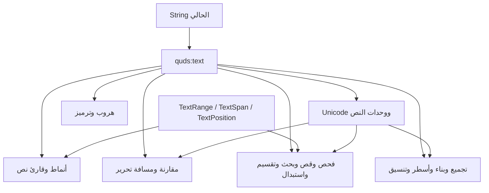

# مخطط حزمة النصوص العامة — quds:text

**التاريخ:** 2026-11-21. **أساس المراجعة:** `21fce97`.
**الحالة:** مخطط تصميم وتنفيذ مقترح، وليس إعلانًا عن مكتبة منفّذة.

هذه الحزمة للنصوص في أي برنامج: القراءة، البناء، التقسيم، البحث، التحويل،
المقارنة والترميز. لا نضع فيها ميزات خاصة بمحرر أو Flutter أو البريد أو
الهواتف أو لغة بشرية بعينها.

المطلوب ملف SDK واحد منظم بـsections، على نمط `lib/sdk/math.quds`، مع أنواع
مشتركة قليلة وواجهات قابلة للاستيراد حسب الحاجة. لا يُنشأ ملف
`lib/sdk/text.quds` فارغًا الآن حتى لا يبدو أن المكتبة متاحة قبل تنفيذها.

## تسمية الحزمة وحدود هذا التحديث

**التوصية: `quds:text` بدل `quds:strings`.** `String` هو نوع القيمة، بينما
text يصف المجال الأوسع: Unicode، الأسطر، القراءة والبناء، الأنماط والترميز.
الاسم قصير، واضح، ومتسق مع `quds:math`. `quds:strings` مفهوم أيضًا لكنه يوحي
أكثر بمجموعة مساعدات لـString؛ لا ننشئ الاسمين معًا أو alias دون حاجة.

**طلب المالك في هذا التحديث:** نقل كل إضافات النصوص من `quds:ext` إلى
الحزمة الجديدة ضمن الخطة فقط. تصبح `quds:text` موطن التعريف والتنفيذ والتوثيق
والاختبارات لهذه الإضافات؛ يبقى ext مدخل توافق عند التنفيذ، لا موطنًا ثانيًا
للمنطق. لا توجد حزمة نصوص منفّذة بعد، ولا ينقل هذا المستند أي مصدر فعلي.

## 1. الصورة العامة



### ما يبقى في أصل اللغة

- `String`، literals، interpolation، الفهرسة والشرائح المعتمدة.
- `+` و`*` والعمليات النصية المقررة في المواصفة.
- الحلقات والأنماط العامة والاستيراد والإكمال.

### ما تضيفه الحزمة

- دوال نصية عامة وأنواع نتائج وخيارات وإجراءات ذات حالة.
- توحيد العقود والتوثيق والاختبارات عبر VM وJavaScript.
- واجهة Unicode صريحة دون تغيير معنى العمليات الحالية بصمت.

لا ننشئ كلاسًا بديلًا لـ`String`، ولا كلاس `TextUtils` ضخمًا، ولا نحتاج كلاسًا
لكل دالة. الكلاسات للحالة أو الخيارات المعاد استخدامها أو النتائج المركبة.

## 2. الموجود حاليًا وما لا نكرره

هذا جرد من المصدر، وليس شهادة اكتمال Unicode أو جميع التواقيع.

| المكان | الموجود | أثره على الخطة |
|---|---|---|
| المترجم/المواصفة | interpolation ودمج وتكرار النص، فهرسة وشرائح، `substring`، `contains`، `startsWith`، `endsWith`، `split`، `indexOf`، `replaceAll`، `trim`، تغيير حالة الأحرف | لا نعيد اختراع هذه العمليات أو نغيّر معاملاتها ضمن الحزمة |
| مساعدات المترجم | `take`، `drop`، `takeLast`، `dropLast`، `padStart`، `padEnd`، و`chars` و`lines` | نثبت سلوكها ووحداتها قبل ربط واجهات جديدة بها |
| `lib/sdk/ext.quds`، extension باسم `Text` | `blank`، `capitalized`، `reversed`، `count`، `removePrefix`، `removeSuffix`، `before`، `after`، `repeated`، `words`، `truncate`، `quoted` | هذه أسماء موجودة فعلًا؛ لا نقدمها على أنها إضافات جديدة |

**تفاصيل مهمة من التنفيذ الحالي:**

- `blank()` في `quds:ext` يفحص المسافة العادية، وليس كل Unicode whitespace.
- `words()` هناك يقسم على المسافة العادية، وليس تقسيم كلمات Unicode كاملًا.
- `count(part)` يحسب التداخلات، ويعيد صفرًا للنمط الفارغ.
- `before` يعيد النص كله عند غياب العلامة، بينما `after` يعيد نصًا فارغًا.
- `truncate(limit)` يقص بلا علامة حذف؛ `quoted()` يحيط بعلامتي اقتباس دون
  أن يصبح بذلك encoder للهروب من المحارف.
- لا نفترض أن `chars` أو `reversed()` الحاليين يتعاملان مع المحرف المرئي
  والإيموجي المركب. نثبّت ذلك باختبارات قبل أي ترحيل.

المراجع: `lib/src/semantics.dart`، `lib/src/emitter.dart`، `lib/sdk/ext.quds`،
و`docs/EDITOR_CONSOLE_INSTALL_FOLLOWUP.md`.

## 3. تقسيم ملف SDK نفسه

**المسار المخطط:** `lib/sdk/text.quds`.

```text
lib/sdk/text.quds
│
├── :: types        الأنواع والمواقع والأخطاء المشتركة
├── :: unicode      وحدات النص والمحارف المرئية والتطبيع
├── :: inspect      الفحص والتحقق العام
├── :: slice        المقاطع والحدود والنوافذ
├── :: patterns     الأنماط الحرفية والمنتظمة
├── :: search       البحث ونتائج المطابقة
├── :: split        التقسيم والفصل
├── :: replace      الاستبدال والتحويل حسب المطابقة
├── :: compose      التجميع والتكرار والإحاطة
├── :: format       التعبئة والمحاذاة والاختصار والالتفاف
├── :: lines        الأسطر ونهاياتها والمسافات البادئة
├── :: builder      البناء المتكرر بكفاءة
├── :: reader       القراءة المتتابعة من نص
├── :: compare      المقارنة والترتيب ومسافات التحرير
├── :: escape       الاقتباس والهروب الصريح
├── :: encoding     التحويل بين النص والبايتات
└── :: extensions   واجهة String الاختيارية
```

أسماء الأقسام كاملة وواضحة. يمكن لاحقًا إضافة قسم فرعي عند اتساع مجال معين،
مثل `:: unicode::normalization`، دون توزيع المجال الواحد عشوائيًا بين أقسام.

### نمط الاستيراد المستهدف

الأمثلة التالية **تصميم للواجهة المستقبلية**؛ `quds:text` غير منفّذة الآن.

```quds
use quds:text::search as search
use quds:text::builder show TextBuilder
use quds:text::types show TextRange
```

لمن يريد كل الأسماء ضمن prefix:

```quds
use quds:text as text
```

لا نفترض أن استيراد قسم يجلب أسماء كل الأنواع من الأقسام الأخرى إلى نطاق
المستخدم. تُختبر التبعيات والتواقيع، ويستورد المستخدم نوعًا مشتركًا صراحةً
إذا أراد ذكر اسمه في annotation.

## 4. قواعد موحدة لكل الأقسام

### 4.1 وحدات النص

| الوحدة | معناها | أين تُستخدم؟ |
|---|---|---|
| UTF-16 code unit | وحدة تخزين String المتوافقة مع Dart | `TextRange` والربط بالعمليات الحالية |
| Unicode code point | نقطة Unicode، وقد تشغل وحدتي UTF-16 | `TextCodePoints` |
| Grapheme cluster | محرف مرئي قد يتكون من عدة code points | `TextCharacters` والقص المرئي |
| Byte | بايت من ترميز معلن | قسم `encoding` فقط |

- `TextRange.start/end` إزاحات UTF-16 صفرية البداية؛ `end` غير مشمول.
- `TextPosition.offset` إزاحة UTF-16؛ السطر والعمود يبدأان من واحد، والعمود
  بوحدات UTF-16. يُحسب CRLF كنهاية سطر واحدة.
- فهرس `TextCharacters` يعد المحارف المرئية. التحويل إلى UTF-16 عملية صريحة.
- لا نغيّر معنى `String.length` أو فهرسته أو `chars` بصمت.
- لا نساوي عدد المحارف المرئية بعرض خط بالبكسل أو بعرض terminal columns.

### 4.2 الغياب والخطأ

- البحث الذي لا يجد نتيجة يعيد `null` أو iterable فارغًا حسب نوع العملية.
- دالة `tryRead...` تعيد `null` عند الفشل وتعيد موضع القارئ إلى بدايته.
- دالة `read...` المطلوبة تفشل بخطأ يوضح الموضع والسبب.
- إزاحة خارج النص أو مجال مقلوب: خطأ حدود، لا قص صامت إلى قيمة أخرى.
- نستخدم `ArgumentError` و`RangeError` الموجودين عندما يكفي معناهما.
- الخيارات متعددة الاحتمالات تكون enum، لا أرقامًا سحرية أو bool غير واضح.

### 4.3 العقود العامة

- النصوص immutable. بناء نتيجة لا يغيّر المدخل.
- التقييم من اليسار إلى اليمين ومرة واحدة، بما فيه callbacks.
- لا استهلاك كامل أو إعادة تعداد iterator لمجرد معرفة طوله.
- الدوال الجديدة لا تلغي سلوك دوال `quds:ext` القديمة المختلفة.
- لا `dynamic` لإخفاء نقص في الأنواع أو في حدود المكتبات.

## 5. أقسام الحزمة بالتفصيل

التواقيع والأسماء أدناه عقود مقترحة للمراجعة، وليست declarations جاهزة
للنسخ إلى SDK دون أجسام تنفيذ واختبارات. القيم الافتراضية المذكورة بالنثر
جزء من الخطة، وتُثبت قبل اعتماد كل دفعة.

### 5.1 `:: types` — الأنواع المشتركة

| النوع | البيانات والمسؤولية |
|---|---|
| `TextRange` | `start`، `end`، `length`، `isEmpty`؛ مجال UTF-16 غير شامل النهاية |
| `TextSpan` | مصدر String ومجال صحيح؛ `value`، وإمكانية اشتقاق span أصغر |
| `TextPosition` | `offset`، `line`، `column` وفق الوحدة المحددة أعلاه |
| `TextBoundaryPolicy` | رفض موضع داخل محرف، أو الانتقال صراحةً للحد السابق/التالي |

**الدوال:**

- `validateTextRange(text, range)` للتحقق من الحدود.
- `intersectTextRanges(first, second)` يعيد المجال المشترك أو `null`.
- `textPositionAt(text, offset)` و`textOffsetAt(text, line, column)`.

`TextSpan` قد يحتفظ بالنص الأصلي كاملًا. نوثّق ذلك ونوفّر خيار materialization
عند الحاجة، دون وعد بتمثيل داخلي أو مشاركة تخزين لا نتحكم فيها.

### 5.2 `:: unicode` — المحارف ووحدات Unicode

| الكلاس/النوع | واجهته الأساسية |
|---|---|
| `TextCharacters` | `count`، قراءة محرف، التكرار، القص بالمحارف، مجال كل محرف في المصدر |
| `TextCodePoints` | `count`، قراءة code point، التكرار، التحويل إلى إزاحات UTF-16 |
| `TextNormalizationForm` | `nfc`، `nfd`، `nfkc`، `nfkd` |
| `TextNormalizer` | إعداد صيغة تطبيع متكرر؛ `normalize` و`isNormalized` |

**الدوال:** `normalizeUnicode`، `isNormalizedUnicode`، `caseFoldText`،
`reverseCharacters`.

- يثبت إصدار Unicode وتُستخدم بيانات موثقة لـUAX #29 وUAX #15.
- لا نفصل التشكيل عن حرفه ولا أجزاء الإيموجي المركب عند القص المرئي.
- لا نصلح UTF-16 التالف بصمت؛ السياسة الصارمة أو التعويض تُعلن صراحةً.
- حالة الأحرف الكاملة ليست مجرد `toLowerCase`، وقد تغيّر طول النص.
- أول تنفيذ للتطبيع والبحث لا يدّعي حفظ مواقع الأصل بعد التحويل. ذلك يحتاج
  mapping موثقًا واختبارات، خصوصًا عند التوسع أو إعادة ترتيب المحارف.

### 5.3 `:: inspect` — الفحص العام

**لا يحتاج كلاسًا مستقلًا.**

| الدالة | الغرض |
|---|---|
| `isBlankText(text)` | فارغ أو Unicode whitespace وفق تعريف موثق |
| `hasText(text)` | هل توجد قيمة نصية غير فارغة وغير blank؟ يقبل nullable صراحةً |
| `blankTextToNull(text)` | يحوّل blank إلى null ويحافظ على غيره دون trim خفي |
| `containsOnlyCharacters(text, allowed)` | كل المحارف المرئية ضمن المجموعة المسموحة |
| `hasLineBreak(text)` | وجود نهاية سطر معتمدة |
| `isWellFormedUnicode(text)` | صحة تسلسل UTF-16 |

لا نعيد إضافة `isEmpty` و`isNotEmpty` الموجودتين. ولا نسمّي فحصًا ASCII عامًا
باسم يوحي بأنه يتعامل مع كل Unicode.

### 5.4 `:: slice` — المقاطع والحدود

**الأنواع المستخدمة:** `TextRange` و`TextSpan` و`TextCharacters`.

**الدوال:**

- `sliceText(text, range)` وفق UTF-16.
- `sliceCharacters(text, start, end)` وفق المحارف المرئية.
- `beforeText(text, marker)`، `afterText(text, marker)`.
- `beforeLastText(text, marker)`، `afterLastText(text, marker)`.
- `betweenText(text, startMarker, endMarker)`.
- `textWindows(text, size, step)` للنوافذ ذات وحدة معلنة.

دوال العلامات الجديدة تعيد `String?` عندما تغيب العلامة. يبحث `betweenText`
عن النهاية بعد نهاية علامة البداية. نرفض العلامة الفارغة في هذه الدوال لتجنب
نتائج مبهمة؛ هذا لا يغيّر `before/after` الموجودتين في `quds:ext`.

### 5.5 `:: patterns` — الأنماط

| النوع | الغرض |
|---|---|
| `TextPattern` | نمط حرفي أو regex مُعدّ لإعادة الاستخدام |
| `TextPatternError` | نمط غير صالح مع النص الأصلي وموضع الخطأ إن توفر |

**إنشاء مقترح:** `TextPattern.literal(...)` و`TextPattern.regex(...)`.

**العمليات:** فحص سريع لوجود مطابقة، وبيانات الخيارات التي يحتاجها قسم البحث.

- لا كتابة محرك regex جديد إذا أمكن استعمال Dart RegExp.
- توثيق الفروق بين VM وJavaScript وحدود النطاق المشترك.
- لا وعد بـtimeout لمحرك regex متزامن لا يمكن إيقافه بهذه الطريقة.
- لا تنفيذ expressions أو كود مضمن داخل pattern.

### 5.6 `:: search` — البحث ونتائج المطابقة

| النوع | البيانات/الإعدادات |
|---|---|
| `TextSearchOptions` | موضع البداية، الحد الأقصى للنتائج، سياسة التداخل |
| `TextMatch` | مجال الأصل، القيمة المطابقة، ومجالات المجموعات المسماة/المرقمة إن وُجدت |

**الدوال:**

- `findText(text, pattern)` → `TextMatch?`.
- `findLastText(text, pattern)` → `TextMatch?`.
- `findAllText(text, pattern)` → `Iterable<TextMatch>`.
- `countTextMatches(text, pattern)` → `int`.
- `containsTextPattern(text, pattern)` → `bool`.

**العقد:** البحث الافتراضي حرفي حساس لحالة الأحرف، دون تطبيع خفي. `findAll`
افتراضيًا غير متداخل؛ التداخل خيار معلن. المطابقات ذات الطول صفر تتقدم وفق
قواعد المحرك كي لا تدور بلا نهاية. مجالات النتائج دائمًا في النص الأصلي.

البحث بعد full case folding أو normalization دفعة لاحقة؛ لا نرجع إزاحات
النص المحوّل ونقدّمها على أنها إزاحات الأصل.

### 5.7 `:: split` — التقسيم والفصل

| النوع | الغرض |
|---|---|
| `TextSplitOptions` | `keepEmpty`، أقصى عدد للفواصل، والاحتفاظ بالفواصل |
| `TextPartition` | `before`، `separator`، `after`، `found` |

**الدوال:**

- `splitText` و`splitTextAny` و`splitTextPattern`.
- `splitTextOnce` و`splitTextLastOnce` → `TextPartition`.
- `textSegments` → مقاطع ذات مجالات بدل نسخ كل جزء فورًا.

**العقد:** نحافظ على الأجزاء الفارغة افتراضيًا. `maxSplits = 0` يعني عدم
التقسيم، ولا نخلط عدد الفواصل بعدد الأجزاء. الفاصل الحرفي الفارغ مرفوض هنا؛
من يريد محارف يستعمل `TextCharacters`. وعند تعدد فواصل تبدأ في الموضع نفسه
نفضّل الأطول، ثم ترتيب تعريف الفواصل عند التعادل.

### 5.8 `:: replace` — الاستبدال والتحويل

**لا نحتاج `TextReplacer` في البداية**؛ إعداد pattern موجود أصلًا.

**الدوال:**

- `replaceFirstText`، `replaceLastText`، `replaceAllText`.
- `replaceTextMatches(text, pattern, transform)`؛ callback يستقبل `TextMatch`.
- `removeTextMatches`.
- `removeTextPrefix`، `removeTextSuffix`، `removeTextSurrounding`.
- `collapseRepeatedCharacters` مع تحديد الوحدة صراحةً.

تُجرى المطابقة على المصدر الأصلي. لا نبحث مرة أخرى في النص البديل أثناء نفس
العملية. الاستبدال النصي حرفي افتراضيًا؛ لا تفسير خفي لـ`$1` ونحوه، والوصول
للمجموعات يكون عبر callback أو API صريح لاحقًا.

نحافظ على Unicode عند حدود المقاطع، ولا نخفي أن ضم مقطعين قد يغيّر تقسيم
المحارف المرئية عند نقطة الالتقاء.

### 5.9 `:: compose` — التجميع والتكرار والإحاطة

**الدوال:**

- `joinText(parts, separator)` و`joinNonBlankText(parts, separator)`.
- `repeatText(text, count, separator)`.
- `surroundText(text, prefix, suffix)`.
- `ensureTextPrefix` و`ensureTextSuffix`؛ لا يكرران الموجود.
- `interleaveText(parts, separator)` عندما تكون النتيجة أجزاء كسولة مطلوبة.

لا ننشئ أسماء مكررة إذا كان `Iterable<String>.join` يغطي الاستعمال نفسه.
تُعتمد الدالة الإضافية فقط إذا أضافت عقدًا واضحًا أو كانت واجهة موحدة لأقسام
الحزمة. `repeatText` دون فاصل يتوافق مع `*` الحالي؛ يثبت سلوك الصفر والسالب
باختبارات ولا يتغير سلوك المعامل القديم بصمت.

### 5.10 `:: format` — التعبئة والمحاذاة والاختصار

| النوع | الغرض |
|---|---|
| `TextAlignment` | `start`، `end`، `center` بالترتيب المنطقي للنص |
| `TextWrapOptions` | حد المحارف، فواصل الكلمات، وهل يسمح بقص كلمة طويلة |

**الدوال:**

- `alignText(text, width, alignment, fill)`.
- `truncateText(text, maxCharacters, suffix)`.
- `wrapText(text, options)` → أسطر، و`wrapTextJoined` لنتيجة String.

الوحدة الجديدة هنا المحرف المرئي، وليست عرضًا بالبكسل. في `truncateText`
يدخل suffix ضمن الحد الكلي؛ السالب خطأ، والصفر يعطي نصًا فارغًا. إذا لم يتسع
الحد للعلامة نفسها، تُقص العلامة على حدود المحارف إلى الحد المطلوب.

التعبئة لا تقص النص الأطول من width. عند الحاجة للتعبئة، تُكرر fill وتُقص
بالمحارف للوصول للعرض المحدد؛ fill الفارغة حينها خطأ. هذا عقد جديد واضح،
ولا نضعه مكان `padStart/padEnd` الحاليين اللذين قد يختلف سلوك fill فيهما.

### 5.11 `:: lines` — الأسطر

| النوع | الغرض |
|---|---|
| `TextLines` | قراءة الأسطر مع إمكانية معرفة مجالاتها ونهاياتها الأصلية |
| `TextLineEnding` | `lf`، `crlf`، `cr` |

**الدوال:** `splitTextLines`، `joinTextLines`، `normalizeLineEndings`،
`indentText`، `dedentText`، `trimBlankLines`.

- تُميز نهاية السطر عن محتوى السطر.
- حفظ السطر الفارغ الأخير خيار معلن، ولا يتغير حسب المنصة.
- لا تحويل تلقائي للتبويب إلى مسافات؛ سياسة tabs مطلوبة في dedent.
- لا نستخدم لغة جهاز المستخدم لتحديد newline افتراضي غير قابل للتوقع؛ LF
  افتراضي المكتبة، ونهايات أخرى باختيار صريح.

### 5.12 `:: builder` — البناء بكفاءة

**الكلاس:** `TextBuilder`.

| المجموعة | الأعضاء |
|---|---|
| إضافة | `append`، `appendLine`، `appendAll`، `appendJoined`، `appendCodePoint` |
| حالة | `utf16Length`، `isEmpty`، `isNotEmpty` |
| نتيجة | `build`، `clear` |

- `appendAll` يستهلك iterable مرة واحدة.
- `build` يعيد String ثابتًا لا يتغير بتعديل builder لاحقًا.
- لا بناء تراكميًا بـ`result = result + part` في حلقة كبيرة إذا أدى إلى كلفة تربيعية.
- عدد المحارف المرئية ليس مجموع أعدادها في الأجزاء: إضافة combining mark قد
  تدمجه بالمحرف السابق. لا نعرض character count مزيّفًا ثابت الكلفة.
- لا نضيف insert/delete عشوائيين إلى builder قبل الحاجة؛ ذلك أقرب لبنية تحرير
  نص، وليس مطلوبًا لحزمة عامة في دفعتها الأولى.

### 5.13 `:: reader` — القراءة المتتابعة

| النوع | الغرض |
|---|---|
| `TextReader` | String وموضع قراءة UTF-16 وحفظ/استعادة checkpoint |
| `TextParseError` | سبب الفشل وموضعه، بلا تبعية لمحرر أو ملف |

**الأعضاء:**

- `position`، `remaining`، `isAtEnd`.
- `peekCharacter`، `readCharacter`، `readUntil`، `readWhile`.
- `skipWhitespace`، `expectText`، `tryReadText`.
- `readQuoted`، `tryReadInt`، `readInt`، `tryReadDouble`، `readDouble`.
- `savePosition` و`restorePosition`.

القراءة الفاشلة من `tryRead` لا تستهلك جزءًا من المدخل. تُحدد صيغة الأرقام
والاقتباس بوضوح؛ لا استنتاج locale أو تاريخ أو عملة أو نوع بيانات تجاري.
لا نسجل remaining كنسخة جديدة في كل خطوة إن لم يحتج المستخدم القيمة.

### 5.14 `:: compare` — المقارنة والمسافة

| النوع | الغرض |
|---|---|
| `TextComparisonOptions` | سياسة حالة الأحرف والتطبيع الصريح عند دعمها |

**الدوال:**

- `compareText`، `equalsText`.
- `compareTextNaturally` للأجزاء الرقمية داخل النص دون parser لإصدارات أو تواريخ.
- `commonTextPrefix`، `commonTextSuffix`.
- `editDistance` و`boundedEditDistance`.
- `textSimilarity` بمعادلة معلنة، لا نتيجة «ذكاء» مبهمة.

المقارنات حتمية ومستقلة عن إعداد الجهاز افتراضيًا. لا ندعي ترتيبًا بشريًا
صحيحًا لكل اللغات. تعادل الأجزاء الرقمية مع أصفار البداية له tie-break ثابت
وموثق. الدفعة الأولى تقيس مسافة Levenshtein بوحدة معلنة وحدود للمدخل؛ النسخة
المحدودة تعيد `null` عند تجاوز maxDistance بدل الادعاء بإرجاع المسافة الدقيقة.

إذا اعتُمد score مشتق، تكون معادلته `1 - distance / max(lengthA, lengthB)`؛
النصان الفارغان يعطيان 1. لا نستخدمه مقياسًا لمعنى الجمل أو تشابهها الدلالي.

### 5.15 `:: escape` — الاقتباس والهروب

**الدوال:**

- `escapeTextLiteral` و`unescapeTextLiteral` وفق مجموعة escapes معلنة.
- `quoteTextLiteral` و`unquoteTextLiteral`؛ الأولى تضيف الاقتباس وتُهرب محتواه.
- `escapeRegexLiteral` لتحويل نص عادي إلى pattern حرفي آمن للمحرك المستعمل.

لا نخلط `surroundText` مع quoting، ولا مع JSON/HTML/URL. تلك تنسيقات لها
قواعد مختلفة ويمكن توفير adapters مستقلة لها أو استخدام مكتباتها الموجودة.
لا دالة عامة باسم يوحي أن النص صار «آمنًا لكل السياقات».

### 5.16 `:: encoding` — النص والبايتات

| النوع | الغرض |
|---|---|
| `TextEncoding` | UTF-8 وUTF-16 LE/BE وASCII وLatin-1 حسب ما يُنفّذ ويُختبر |
| `TextEncodingError` | encoding وموضع الإدخال ووحدته وسبب الفشل |

**الدوال:** `encodeText`، `decodeText`، `detectTextBom`.

تستعمل محولات Dart أو حزمة موثوقة بدل إعادة كتابة codecs بلا حاجة. البايتات
تكون من نوع core موجود إن كان جاهزًا، وإلا واجهة `List<int>` مع التحقق من
النطاق 0..255، دون اختراع ByteBuffer منافس.

UTF-8 الصارم هو الافتراضي المقترح. التعويض عن مدخل تالف اختيار صريح. كشف BOM
ليس تخمين encoding من محتوى عشوائي؛ حفظه أو إزالته يحددان صراحةً، ولا نفقد
بايتات أو محارف دون توثيق.

### 5.17 `:: extensions` — الواجهة الاختيارية على String

**الامتداد المنقول:** يحتفظ extension `Text` الحالي باسمه وهويته عند نقله
إلى `quds:text::extensions` للحفاظ على `show Text` والاستخدامات القديمة.
يعيد `quds:ext` تصدير التعريف نفسه للتوافق، ولا يعرّف نسخة منافسة منه.

**للواجهات الجديدة:** يمكن استعمال `TextStringExtensions` بأسماء مميزة فقط؛
لا نكرر أعضاء `Text` بين امتدادين. هذا لا يستدعي إنشاء كلاس باسم Text.

- الدوال العليا السابقة هي المرجع الأساسي القابل للاستعمال مع prefix.
- extensions مجرد واجهة صغيرة تستدعي التنفيذ نفسه، وليست نسخة أخرى منه.
- استيرادها صريح وغير مسبوق بـprefix وفق قواعد extensions الحالية.
- لا تغيير أو إخفاء methods الأصلية؛ أعضاء `Text` المنقولة تحتفظ بعقودها القديمة.
- إن كان اسم مريح يتصادم، نختار اسمًا مميزًا أو نكتفي بالدالة العليا.

أمثلة مرشحة: `asTextCharacters()`، `normalizedUnicode(...)`،
`findTextMatch(...)`، `repeatedWithSeparator(...)`.
هذه أسماء للمراجعة، وليست قائمة يجب تنفيذها لمجرد وجودها هنا.

## 6. خريطة الأنواع المركزية

| الفئة | الأنواع |
|---|---|
| قيم ومواقع | `TextRange`, `TextSpan`, `TextPosition`, `TextPartition` |
| views | `TextCharacters`, `TextCodePoints`, `TextLines` |
| إعدادات | `TextNormalizer`, `TextSearchOptions`, `TextSplitOptions`, `TextWrapOptions`, `TextComparisonOptions` |
| أنماط ونتائج | `TextPattern`, `TextMatch` |
| حالة متغيرة | `TextBuilder`, `TextReader` |
| أخطاء ذات معنى إضافي | `TextPatternError`, `TextParseError`, `TextEncodingError` |
| enums | boundary policy، normalization form، alignment، line ending، encoding |

لا يعني هذا وجوب تنفيذ كل نوع في الدفعة الأولى. options بسيطة ذات معاملين
قد تبقى معاملات مسماة بدل كلاس مستقل حتى تظهر حاجة فعلية لإعادة استخدامها.

## 7. الاعتماد بين الأقسام

```text
types
  ├─ unicode ── inspect / slice / format / compare
  ├─ patterns ── search ── split / replace
  ├─ lines ── builder / reader
  └─ escape / encoding

compose يستعمل أبسط الأدوات المتاحة ولا يعتمد على extensions.
extensions واجهة أخيرة فوق الأقسام؛ لا يعتمد أي تنفيذ أساسي عليها.
```

لا تجعل `TextPattern` يعتمد على builder أو reader أو extensions. ولا تجعل
بناء النص يحتاج استيراد regex أو codecs. تختبر تبعيات الاستيراد الفعلية قبل
القول إن الأقسام أصبحت مستقلة؛ الرسم هدف تصميمي لا ادعاء عن pruning المولّد.

## 8. أمثلة الواجهة المستهدفة

كل الأمثلة في هذا القسم **مستقبلية**، ولا تعمل بمجرد إضافة هذا المخطط.

### بناء نص

```quds
use quds:text::builder show TextBuilder

main():
  builder = TextBuilder()
  builder.append("Hello")
  builder.appendLine(" Quds")
  builder.appendJoined(["a", "b", "c"], separator: ", ")
  print builder.build()
```

### محارف مرئية

```quds
use quds:text::unicode show TextCharacters

main():
  characters = TextCharacters("قُدس 👨‍👩‍👧‍👦")
  print characters.characterAt(0)
  # قُ
```

### بحث واضح

```quds
use quds:text::patterns show TextPattern
use quds:text::search as search

main():
  found = search.findText("name=value", TextPattern.literal("="))
  if let match = found:
    print match.range.start
```

### فصل يحتفظ بمعنى الغياب

```quds
use quds:text::split as split

main():
  result = split.splitTextOnce("name=a=b", "=")
  print result.before
  print result.after
  print result.found
```

### تكرار بفاصل، دون تغيير المعامل

```quds
use quds:text::compose as text

main():
  print text.repeatText("some", 3, separator: "-")
  # some-some-some
```

## 9. خطة التنفيذ والترحيل

| الدفعة | المحتوى | شرط الإغلاق |
|---|---|---|
| 0 — تثبيت الأساس | جرد APIs، توثيق وحدات String الحالية، تجارب import/sections/extensions/callbacks/iterators | أمثلة قدس فعلية تكشف قدرات المترجم وأي نقص قبل اعتماد التصميم النهائي |
| 1 — نصوص يومية | types، inspect، slice، split الحرفي، compose، builder، lines | كل API عام له استعمال Quds إيجابي وسلبي وعقد للأفرغ/الغياب/الحدود |
| 2 — Unicode | views، grapheme segmentation، normalization، القياس والقص المرئي | اختبارات Unicode رسمية وإصدار بيانات مثبت؛ لا كسر للمحارف المركبة |
| 3 — أنماط وتحويل | patterns، search، replace، reader | نفس النتائج والعقود على VM وJS، مع zero-length matches وrollback |
| 4 — عرض ومقارنة وترميز | format، compare، escape، encoding | حدود كلفة واضحة، اختبارات round-trip وفروق المنصات موثقة |
| 5 — واجهة وترحيل | extensions، الإكمال والتلميحات، توافق quds:ext | لا غموض extensions أو تغيير صامت للسلوك القديم |

### ترحيل `quds:ext` — نقل كامل لملكية إضافات النصوص

النقل مخطط وليس منفّذًا. يشمل أعضاء `extend String Text` الثلاثة عشر جميعها:

| الأعضاء الحالية | القسم المالك للمنطق داخل text | عقد التوافق المطلوب |
|---|---|---|
| `blank` | inspect | الفراغ الحالي هو المسافة العادية، لا Unicode whitespace |
| `capitalized` | format | أول وحدة مفهرسة upper case، والباقي كما هو |
| `reversed` | unicode | تثبيت السلوك الحالي؛ لا استبداله ضمنيًا بعكس graphemes |
| `count` | search | تداخلات محسوبة؛ النمط الفارغ يعطي صفرًا |
| `removePrefix`, `removeSuffix` | replace | حفظ المعاملات وسلوك البادئة/اللاحقة الفارغة |
| `before`, `after` | slice | غياب العلامة يعطي الأصل للأولى والفارغ للثانية |
| `repeated` | compose | العدد غير الموجب يعطي نصًا فارغًا |
| `words` | split | تقسيم بالمسافة العادية وإسقاط الأجزاء الفارغة |
| `truncate` | format | قص بلا suffix؛ الحد غير الموجب يعطي الفارغ |
| `quoted` | escape | إحاطة باقتباسين فقط، دون escaping |

هذا توزيع ملكية للمنطق والتوثيق؛ جميع methods تبقى مجمّعة تحت extension
`Text` في section `extensions`. الدوال الجديدة ذات العقود المختلفة تبقى
متميزة، مثل `isBlankText` و`truncateText`، ولا تصبح بدائل صامتة للأعضاء القديمة.
إذا احتاج العقد القديم مساعدًا داخليًا خاصًا، يبقى داخل text ولا نفرض له API عامًا.

خطة النقل عند بدء التنفيذ:

1. تثبيت الأعضاء الثلاثة عشر باختبارات Quds قبل النقل، بما يشمل الحدود والغياب
   وUnicode والحالات الفارغة. لا يكفي وجود أمثلة أو قراءة المصدر.
2. نقل تعريف `Text` وتنفيذه إلى `lib/sdk/text.quds`، وتوزيع المنطق على الأقسام
   أعلاه حيث يناسب، دون نسختين من الخوارزمية أو تغيير أسماء methods.
3. استبدال تعريف النصوص في ext بإعادة تصدير امتداد `Text` نفسه من text؛ تبقى
   إضافات List والأرقام وبقية الأنواع في ext ولا تدخل هذه الدفعة.
4. اختبار الاستيراد القديم `use quds:ext`، والجديد `use quds:text::extensions`،
   واستيرادهما معًا و`show Text` وhide وprefix وفق القواعد الفعلية. يجب ألا
   ينتج عن إعادة التصدير امتدادان أو تعارض أو اختفاء للإكمال والتلميحات.
5. إذا لم يحفظ المترجم هوية الامتداد عبر section/re-export، إصلاحه باختبارات
   regression قبل النقل؛ لا إنشاء نسختين متطابقتين من extension للتحايل.
6. نقل أمثلة النصوص وتوثيقها إلى text، وتحديث imports الداخلية، وترك توجيه
   في توثيق ext إلى الموطن الجديد. تثبيت التوافق القديم باختبارات مستقلة.
7. لا حذف لمسار ext القديم أو deprecation في هذه الخطة. أي إزالة لاحقة تحتاج
   قرار إصدار مستقل؛ الملكية تنتقل الآن في التصميم، والتوافق يبقى عند التنفيذ.

ترتيب الدفعات: تثبيت الاختبارات في الدفعة 0، ونقل الأعضاء تدريجيًا مع أقسامها
ابتداءً من الدفعة 1، وإغلاق النقل كاملًا في الدفعة 5. لا يُحذف تعريف ext قبل
جاهزية المسار الجديد وإعادة التصدير. النقل لا يشمل عمليات String الأصلية في
المترجم؛ لا تتغير تبعياتها أو صياغتها لمجرد تنظيم SDK.

### تجارب المترجم المطلوبة قبل التوسع

- إرجاع `Iterable<TextMatch>` وviews والتكرار عليها من مكتبة مستوردة.
- قيم callbacks typed عبر حدود المكتبات، خصوصًا مع optional/named arguments.
- enums والأنواع المشتركة في signatures عند استيراد section فقط.
- نتائج nullable والقراءة الآمنة والـnamed constructors المستعملة فعلًا.
- extension imports المتزامنة مع quds:ext ومنع الالتباس.
- Native Dart RegExp/codecs وعملها في VM وJS دون erasure غير مبرر.

إذا كشف التنفيذ نقصًا في المترجم، يُصلح مع regression في قدس أو يُوثّق E910
للنطاق غير المدعوم؛ لا نستبدل النوع بـdynamic ولا نغيّر صياغة معتمدة لتجاوزه.

## 10. ملفات التنفيذ والاختبارات والتوثيق المخططة

```text
lib/sdk/text.quds                     تنفيذ قدس، مقسم بالـsections أعلاه
lib/src/sdk.dart                      ربط المكتبة إن احتاج registry تعديلًا

test/text_<section>.quds              الحالات الأساسية بقدس
test/text_unicode_reference.quds     مرجع Unicode مستقل عند جاهزية القسم
test/text_imports.quds               sections وprefix وshow/hide والتعارضات
test/text_reject_<case>.quds         الحالات المرفوضة عند الحاجة
test/text_sdk_test.dart              تشغيل suites وتحليل الناتج وVM/JS
test/goldens/text_<slice>.dart.txt    الناتج الحتمي للشرائح المختارة

docs/TEXT_SDK_PLAN_AR.md              هذا المخطط وحالة الدفعات
docs/TEXT_REFERENCE.md               مرجع API الإنجليزي عند التنفيذ
docs/VALIDATION.md                   أوامر الفحص ونتائجها الدقيقة
```

تُضاف الملفات عند بدء دفعتها الفعلية، لا تُنشأ tests فارغة لإظهار تقدم غير حقيقي.

## 11. مصفوفة الاختبارات

| الجانب | أمثلة إلزامية |
|---|---|
| حدود | فارغ، عنصر واحد، بداية/نهاية، مجال فارغ، سالب وخارج النطاق |
| Unicode | ASCII، نص مشكّل، combining marks، supplementary characters، أعلام وإيموجي ZWJ، UTF-16 تالف |
| البحث | غياب، تكرار، تداخل، pattern فارغ، match صفرية، مجموعات غير مشاركة |
| التقسيم | فواصل متجاورة، بداية/نهاية، غياب، حد عدد الفواصل، فواصل متعددة متداخلة |
| الأسطر | LF وCRLF وCR، سطر أخير فارغ، tabs، نص مختلط النهايات |
| reader | نجاح، فشل مع rollback، checkpoint، نهاية المدخل، خطأ موقعه صحيح |
| encodings | round-trip، بايت خارج 0..255، تسلسل تالف، BOM، حدود ASCII/Latin-1 |
| خواص | تطبيع idempotent، قص/وصل عند حدود صحيحة، compare مضاد التماثل ومتعدٍ |
| كلفة | نصوص طويلة، أجزاء كثيرة، iterator أحادي الاستهلاك، regex دون وعود timeout وهمية |
| تكامل | import انتقائي ومسبوق، ext مع text، إكمال وhover، VM وJS فعليان |

ليس كل تحول قابلًا للعكس؛ لا نكتب property من نوع normalize→denormalize
أو إزالة مسافات→استرجاع الأصل. وjoin(split(x)) يساوي x فقط تحت شروط معلنة.

## 12. بوابة القبول وحالة التسليم

عند تنفيذ أي دفعة:

1. تحديث هذا الملف بجدول APIs المنفّذة والمتبقية وروابط الاختبارات.
2. اختبار السلوك الأساسي بقدس، ثم تحليل Dart المولّد وتنفيذه على VM وJS.
3. تشغيل format/analyze/tests والفحوص المطلوبة للمستودع وفق حجم التغيير.
4. توثيق النتائج الفعلية، والكلفة أو القيود المهمة، دون ادعاء شهادة كل Unicode.
5. رفع كل دفعة مكتملة ومختبرة إلى main وفق تعليمات المستودع.

**حالة هذه الدفعة:** توثيق وتصميم فقط؛ لا SDK جديد ولا تعديل لصياغة اللغة.
جرد الموجود أعلاه قائم على قراءة المصدر. لم تُشغّل اختبارات runtime لإثبات
واجهات مستقبلية غير منفّذة، ولم تتغير حالات جاهزية القواعد الـ115.
